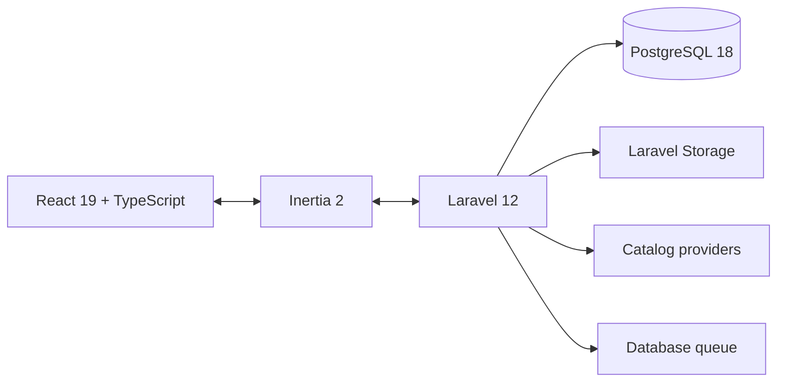

# BlackFrame

<p align="center">
  <strong>A culture-aware social network for sharing life, curating a personal shelf, and meeting people through shared taste.</strong>
</p>

<p align="center">
  Made by <strong>Celso Blackfyre</strong>
</p>

<p align="center">
  
  
  
  
  
</p>

BlackFrame began as an Instagram-inspired Laravel project and evolved into its own social experience. It combines a visual Home timeline, conversation-first Pulse posts, a structured culture catalog, personal Geek Shelves, transparent compatibility matching, and private Direct conversations.

## What BlackFrame includes

| Experience      | What it does                                                                                                     |
| --------------- | ---------------------------------------------------------------------------------------------------------------- |
| **Home**        | A visual-first timeline with a lightweight composer, culture context, and new-member activation path.            |
| **Pulse**       | A conversation-first timeline for short text posts over the same social graph.                                   |
| **Profiles**    | Connects each identity to their visual posts, Pulse updates, shared culture, read-only shelf, and About view.    |
| **Geek Shelf**  | Tracks books, games, films, series, anime, comics, and fandoms with status, progress, ratings, and favorites.    |
| **Catalog**     | Searches local and external title sources without forcing users to build the catalog manually.                   |
| **Discover**    | Finds people by name and relationship while prioritizing shared titles, current activity, and mutual context.    |
| **Shelf Match** | Finds people through shared titles and explains compatibility through overlap, favorites, statuses, and ratings. |
| **Direct**      | Gives mutual Shelf Matches one private conversation with unread state and shared-title context.                  |

Additional foundations include authentication, password reset, private-profile follow approval, protected image uploads, likes, follows, comments schema, rate limiting, responsive navigation, light and dark themes, and accessibility-focused interaction states.

## Product principles

- Shared culture is structured data, not an unmanageable free-text list.
- Compatibility is explainable and never based on demographics or follower counts.
- A Direct conversation opens only after both people choose **Connect**.
- Laravel owns security, validation, authorization, persistence, and routing.
- React owns the interactive interface through Inertia; there is no unnecessary separate API.
- PostgreSQL constraints are treated as part of application correctness.

## Architecture



The application is a Laravel monolith with server-driven Inertia pages. Domain services isolate feed selection, catalog federation, title importing, shelf compatibility, media persistence, people discovery, and Direct conversation behavior.

### Main technology

- PHP 8.2+ and Laravel 12
- React 19, TypeScript, and Inertia 2
- Tailwind CSS 4 and Radix UI primitives
- PostgreSQL 18.6 through Docker Compose
- Vite 6, Lucide icons, Outfit Variable, and focused GSAP motion
- PHPUnit, Laravel Pint, ESLint, Prettier, and GitHub Actions

## Local development

### Requirements

- PHP 8.2 or newer with `pdo_pgsql`
- Composer 2
- Node.js 22 and npm
- Docker Desktop

### First-time setup

```powershell
git clone https://github.com/CelsoBlackfyre/blackframe.git
cd blackframe
composer install
npm install
Copy-Item .env.example .env
php artisan key:generate
composer run db:start
php artisan migrate --seed
php artisan storage:link
composer run dev
```

Open [http://localhost:8000](http://localhost:8000).

The combined development command starts PostgreSQL when necessary, applies safe pending migrations, and launches Laravel, the queue listener, application logs, and Vite.

### Demo account

```text
Email: demo@blackframe.test
Password: password
```

## Database

Development and automated tests both use PostgreSQL 18.6:

- `frame` stores local application data.
- `frame_testing` is isolated for PHPUnit.
- Docker exposes PostgreSQL only on `127.0.0.1:5433`.
- Data persists in the `frame_frame-postgres-data` Docker volume.

Useful commands:

```powershell
composer run db:start
composer run db:status
composer run db:stop
```

Do not run `php artisan migrate:fresh --seed` against data you need to keep; it intentionally drops every application table.

## Quality checks

```powershell
php artisan test
npx tsc --noEmit
npx eslint .
npm run format:check
php vendor/bin/pint --test
npm run build
```

The current verified baseline is **87 tests with 823 assertions**.

## Security posture

- Private accounts use pending follow requests; only accepted relationships unlock profile content, matching context, post interactions, and uploaded media.
- Post media is stored outside the public web root and served through authenticated post authorization.
- Account-sensitive endpoints are throttled, and password changes or resets rotate persistent login tokens and invalidate database-backed sessions.
- Production requests use exact trusted-host validation plus baseline anti-framing, MIME-sniffing, referrer, permissions, and transport-security headers.
- Composer and npm dependency audits are part of release verification.

## Production deployment

The repository includes an ARM64-compatible production image and a hardened
single-VM Docker Compose stack for Oracle Cloud Always Free. The deployment runs
Caddy, Laravel, a database queue worker, and PostgreSQL without publishing the
application or database containers directly.

The initial launch is accessible only through an SSH tunnel. The production
runbook covers OCI provisioning, secrets, persistent volumes, SMTP, instance-
principal backups, restore verification, and the later domain/HTTPS cutover.
See the [Oracle Cloud deployment guide](deploy/oracle/README.md).

## Project map

```text
app/                  Laravel models, requests, policies, controllers, and services
database/             PostgreSQL migrations, factories, and development seeders
resources/js/         React pages, layouts, components, and TypeScript contracts
resources/css/        Tailwind entry point and BlackFrame theme tokens
routes/                Authenticated web, settings, and authentication routes
tests/                 PHPUnit unit and feature coverage
design-system/         Product-wide and page-specific interface rules
```

## Documentation

- [AI context](AI_CONTEXT.md) — self-contained, ChatGPT-ready product and development context
- [Project context](PROJECT_CONTEXT.md) — complete product and technical handoff
- [Architecture](ARCHITECTURE.md) — backend boundaries, schema, security, and roadmap
- [Catalog](CATALOG.md) — title sources, signed imports, caching, and moderation
- [Design system](design-system/blackframe/MASTER.md) — visual and interaction source of truth
- [Everyday design contract](DESIGN.md) — concise UI implementation guidance
- [Oracle deployment](deploy/oracle/README.md) — Always Free production and operations runbook

## Current boundaries

BlackFrame is an active application foundation, not a production-ready social network. Direct currently refreshes open conversations every ten seconds instead of using WebSockets. Comment authoring, subject pages, carousels, notifications, blocking, reporting, media transformation, and direct application media storage in OCI Object Storage remain future work.

## Author

Designed and developed by **Celso Blackfyre**.

## License

BlackFrame is available under the [MIT License](LICENSE).
